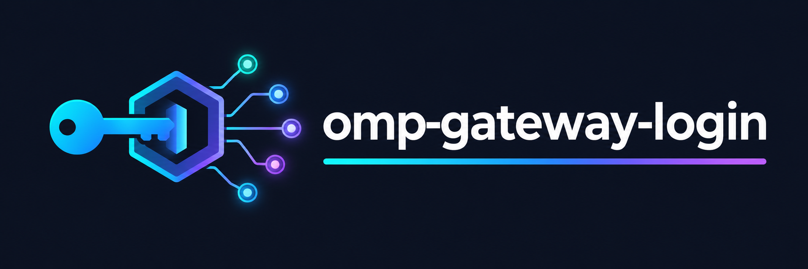

<div align="center">

**English** · [简体中文](README.zh-CN.md)



### Log in to any model gateway with a base URL and an API key — every chat model it serves becomes selectable.

<a href="LICENSE"></a>&nbsp;
<a href="../../releases"></a>&nbsp;
<a href="https://omp.sh"></a>&nbsp;
<a href="package.json"></a>&nbsp;
<a href="../../commits"></a>

</div>

<br>

An [omp](https://omp.sh) ([`@oh-my-pi/pi-coding-agent`](https://github.com/can1357/oh-my-pi), aka oh-my-pi) extension that turns **any** "base URL + API key" gateway into a first-class login provider — CLIProxyAPI, LiteLLM, one-api, new-api, the Volcengine Ark coding plan, in-house routers — as long as the endpoint answers `GET <base URL>/v1/models` and speaks Anthropic Messages (or OpenAI Chat Completions).

One installation fronts **as many gateways as you configure**. You name each one during login, and that name is the model prefix.

## Install

Needs [omp](https://omp.sh) ≥ 18.2.3 (`@oh-my-pi/pi-coding-agent`), the agent that loads this extension.

```bash
omp plugin install git:https://github.com/magic3007/omp-gateway
```

Install from the git URL, not by bare name: the npm package `omp-gateway` belongs to an unrelated project.

## Log in

```bash
omp login                            # pick "Custom gateway (name + base URL + API key)"
                                     #   ① name        e.g. litellm
                                     #   ② base URL    e.g. https://gw.example.com
                                     #   ③ API key     sk-…
                                     #   ④ extra ids   Enter for none
# → Saved gateway "litellm" (48 chat models) … select them as litellm/<id>.
```

The name, URL and key are validated together with one model-list call before anything is stored, so a wrong key or an unreachable URL fails the login instead of adding a broken gateway. Repeat the login for each gateway you want — all of them are registered on every start. (omp's own line about credentials being stored, or not, refers to its credential store; this plugin keeps the key in its own file.)

## Enable the models

omp's `enabledModels` is a strict allow-list, so add one glob per gateway name to `~/.omp/agent/config.yml`:

```yaml
enabledModels:
  - litellm/*
  - volcengine/*

modelRoles:                             # optional aliases
  gw-opus: litellm/claude-opus-4-1:auto
  ark-code: volcengine/ark-code-latest:auto
```

Then use them like any other model:

```bash
omp models list litellm
omp -p --model litellm/claude-opus-4-1 "reply with exactly: OK"
```

## What you get

| Item | Value |
| --- | --- |
| Login entry | `/login` (TUI) or `omp login` (terminal) → `Custom gateway (name + base URL + API key)` |
| Login input | name, base URL, API key, optional extra model ids — all typed by you at login; the plugin reads no environment variables |
| Model prefix | `<name>/<model id>`, e.g. `litellm/claude-opus-4-1`, `volcengine/ark-code-latest` |
| Wire | `anthropic-messages` by default; set `openai-completions` per gateway in the config file |
| Model source | `GET <base URL>/v1/models`, re-fetched on login and on discovery refresh |
| Gateways per install | unlimited — one entry per name in the config file |

Discovery drops what is not a usable chat model (image/video/speech ids, entries the gateway marks as shut down or deprecated) and uses the context window and output cap the gateway reports, falling back to 200k / 64k.

## Managing gateways

Everything lives in one JSON file, `~/.omp/agent/gateways-login.json` (`0600`, plaintext keys — same posture as omp's own credential store):

```json
{
  "providers": [
    { "name": "litellm", "baseUrl": "https://gw.example.com", "api": "anthropic-messages",
      "apiKey": "sk-…", "extraModels": [] },
    { "name": "volcengine", "baseUrl": "https://ark.cn-beijing.volces.com/api/coding",
      "api": "anthropic-messages", "apiKey": "…",
      "extraModels": ["ark-code-latest", "doubao-seed-2.0-pro", "glm-5.3"] }
  ]
}
```

- **Add** — run the login entry again with a new name.
- **Update** — run it with an existing name: Enter keeps the stored URL and key, `-` clears the extra ids.
- **Remove** — delete its object from the file and restart omp.
- **`extraModels`** — model ids the gateway serves but does not list (plan-only aliases, e.g. the Ark coding plan's `ark-code-latest`).
- **`api`** — set `openai-completions` for gateways that only speak OpenAI Chat Completions.

Hand-editing works: `extraModels` and `api` are the fields the login flow does not ask about, and the file is re-validated on load.

Base URLs are stored as the gateway root (`https://gw.example.com`, a trailing `/v1` is stripped); the plugin adds `/v1/models` for discovery, and the `/v1` the OpenAI wire needs. After hand-editing, run `omp models refresh` so the cached catalog is re-read.

## Development

```bash
git clone https://github.com/magic3007/omp-gateway
cd omp-gateway
bun install              # dev only: TypeScript and the omp host types
omp plugin link .        # edits in src/ take effect on the next omp start
bun run typecheck && bun test
```

No runtime dependencies: the entry point is TypeScript source (`package.json#omp.extensions: ["src/index.ts"]`) loaded directly by omp's Bun runtime. Host types come through `import type` only.

Remove: `omp plugin disable omp-gateway` (keep, stop loading) or `omp plugin uninstall omp-gateway`.

See [CHANGELOG.md](CHANGELOG.md) for release notes, [CONTRIBUTING.md](CONTRIBUTING.md) before opening a pull request, and [SECURITY.md](SECURITY.md) for how API keys are stored.

## License

[MIT](LICENSE)
